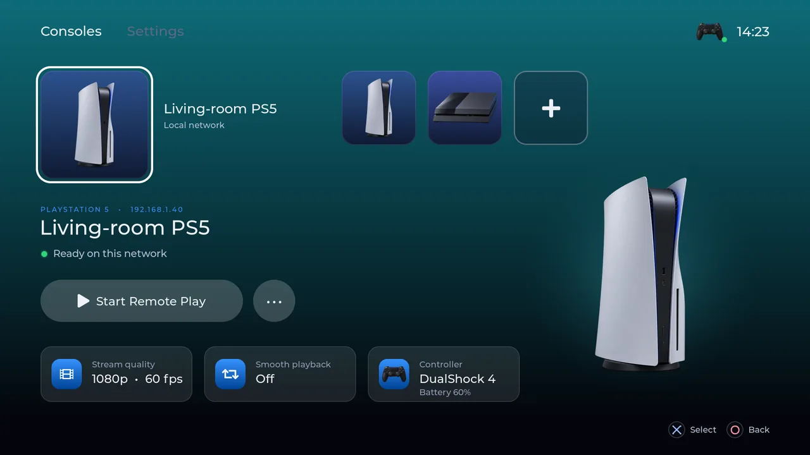
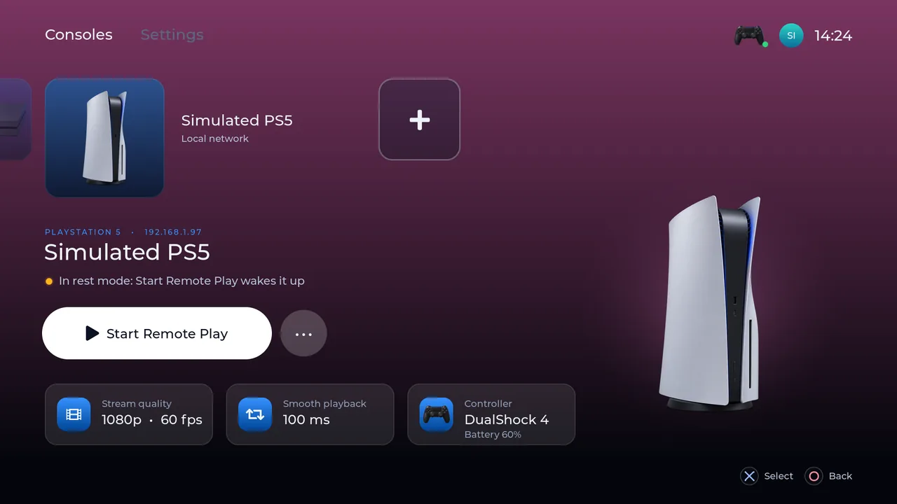
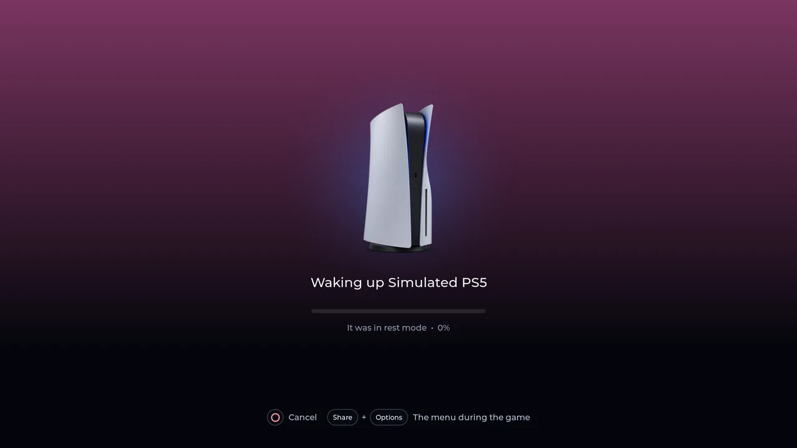
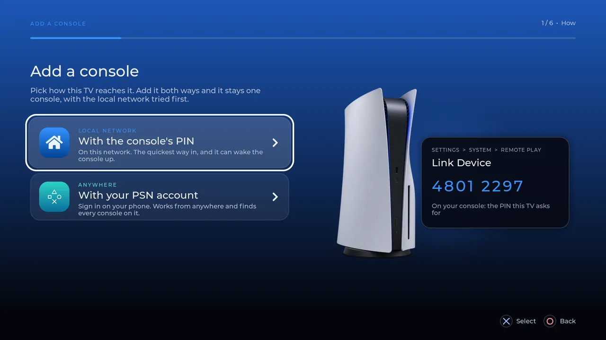
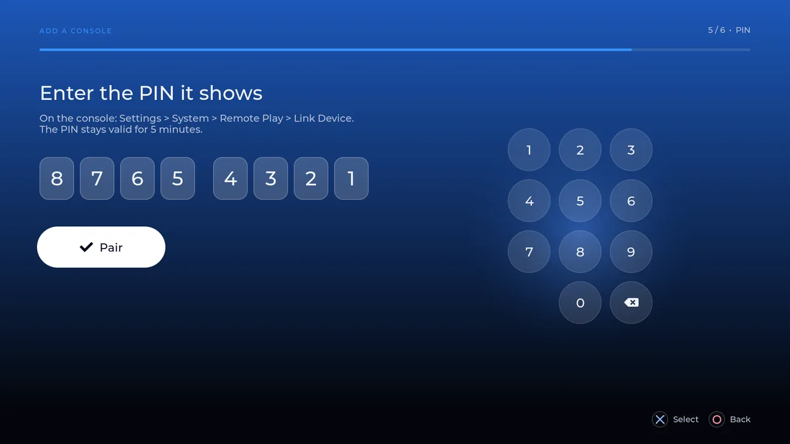
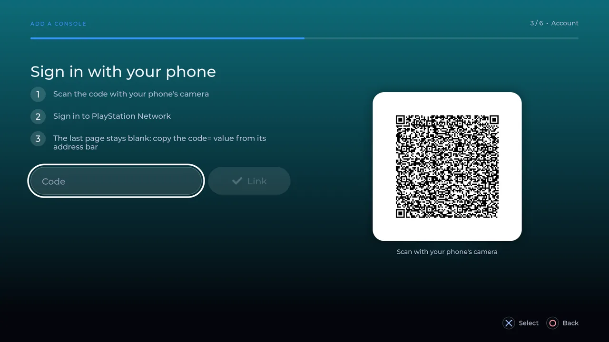
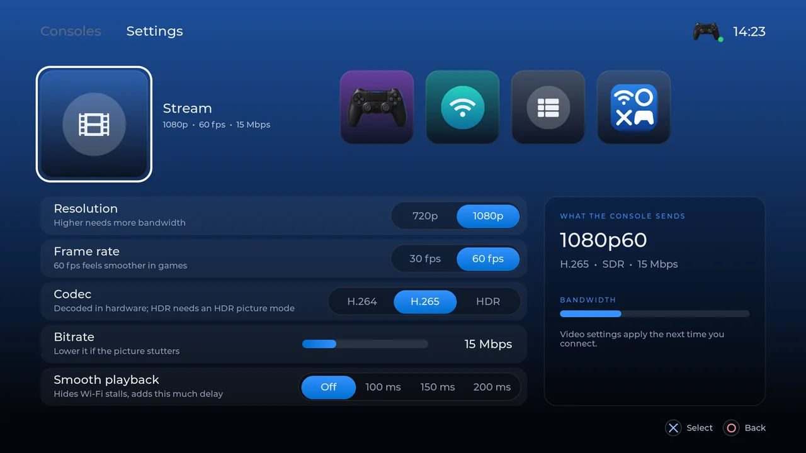
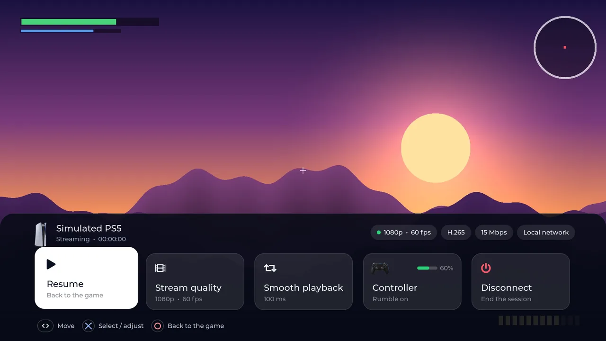
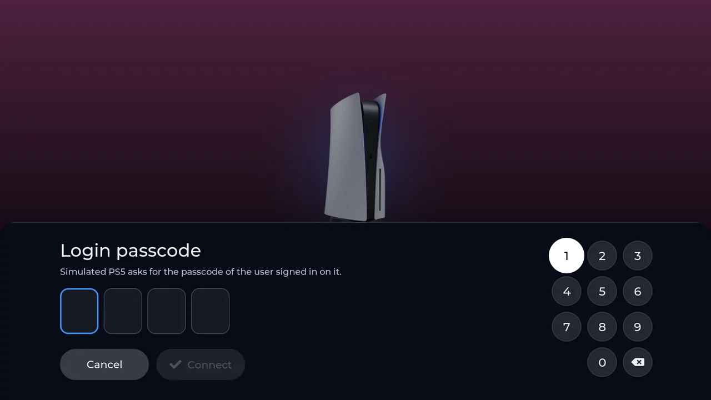

[](https://github.com/renjfk/hotaru-webos/actions/workflows/ci.yml)
[](LICENSE)
[](https://github.com/renjfk/hotaru-webos/releases/latest)
[](https://github.com/renjfk/hotaru-webos/releases)

<p align="center">
 
</p>

# Hotaru

PlayStation Remote Play for LG webOS TVs. A native app built on [chiaki-ng](https://github.com/streetpea/chiaki-ng)'s
libchiaki that streams a PS5 or PS4 to the TV with hardware decoding, played with a DualShock 4 and driven by the
TV remote or the controller.

> [!NOTE]
> This is an early beta, built and tested on one TV (an LG 50UP75003LF on webOS 6). Things may break and other
> TVs are untested. If you run into problems, an [issue](https://github.com/renjfk/hotaru-webos/issues) is always
> welcome.

> [!IMPORTANT]
> Hotaru is not on the LG Content Store: it installs on a TV in Developer Mode (or one rooted with the
> Homebrew Channel). It needs your own PS5 or PS4 with Remote Play turned on.

|                 Home                 |                 Rest mode                  |                 Waking up                  |
|:------------------------------------:|:------------------------------------------:|:------------------------------------------:|
|        |    |    |

|                  Add a console                   |                   Pairing with the PIN                   |                  PSN sign-in                   |
|:------------------------------------------------:|:--------------------------------------------------------:|:----------------------------------------------:|
|    |  |   |

|                Settings                |                 Menu over the game                 |                  Login passcode                  |
|:--------------------------------------:|:--------------------------------------------------:|:------------------------------------------------:|
|  |  |  |

The screens were designed as interactive previews first ([design/menu](design/menu/README.md)). Here is the app on
the TV in one take: Home, Settings, the steps of adding a console, waking a PS5 from rest mode, the game with the
menu over it, and connecting again over PSN. Recorded with a phone, with only the game's sound kept.

https://github.com/user-attachments/assets/2f0ec008-1a7f-4be6-9569-af8d2be790aa

## Motivation

I have wanted to play my PlayStation on the LG TV in another room for a long time. Kodi and Moonlight TV had shown
that webOS handles native apps, hardware video and controllers, so at the end of 2024 I asked the chiaki-ng
developers where a webOS port would start ([chiaki-ng#517](https://github.com/chiaki-ng/chiaki-ng/issues/517)),
but never had the capacity to build it.

Hotaru is the app I had in mind: one made for the TV, with a home screen modelled on the PS5's own, driven
entirely by the remote or the controller, that finds your consoles, wakes them, and carries on over PSN when you are
away. AI-assisted development is what finally made a project of this size possible on the side.

The name is Japanese: hotaru (蛍) is a firefly, a small light glowing in another room.

## Features

- **Remote Play from a PS5 or PS4** on the local network, or over PSN from anywhere (the console is reached
  through PSN's NAT traversal)
- **Hardware decoding** of H.264 and H.265 (and HDR10 on a PS5) through the TV's own media pipeline, with 48 kHz
  audio
- **Smooth playback** - a short playout buffer that hides the stalls a TV's Wi-Fi causes
- **A PS5-style home screen** - consoles as tiles, settings changed in place, everything reachable with the D-pad,
  the left stick or the TV remote; no pointer anywhere
- **Console discovery** - each console shows whether it is ready, in rest mode or away; Start Remote Play wakes a
  console in rest mode first, and a console the router gave a new address is followed
- **One console, two routes** - pair it with its PIN at home and find it through PSN too: it stays one tile, uses
  the local network first and carries on over PSN when the console is not at home
- **Adding a console** - a full-screen setup: the PIN on a big number pad (or the remote's number keys), the
  address filled in when the console is found on the network, PSN sign-in with a QR code for your phone
- **The DualShock 4 is forwarded** - buttons, sticks, triggers, touchpad and rumble; Share + Options opens the
  menu over the game (stream quality, smoothing, controller, disconnect)
- **Diagnostics** - a switch in Settings logs raw input, discovery answers and frame timing, for checking a new
  TV or controller

## Supported Hardware

|                                  | Status                                                               |
|----------------------------------|----------------------------------------------------------------------|
| LG 50UP75003LF, webOS TV 6.5.3   | Developed and tested on                                              |
| Other LG webOS TVs               | Untested: it builds for webOS's ARM toolchain, but needs trying      |
| PS5                              | Streams on the local network and over PSN                            |
| PS4 / PS4 Pro                    | Untested; firmware 7.0 or later needs your PSN account ID to pair    |
| DualShock 4 (Bluetooth)          | Tested, with rumble                                                  |
| DualSense (Bluetooth)            | Tested; webOS passes no rumble, touches or adaptive triggers through |

What is proven on the TV and what only in the tests is tracked in [docs/STATUS.md](docs/STATUS.md).

## Installation

### Requirements

- An LG webOS TV in [Developer Mode](https://webostv.developer.lge.com/develop/getting-started/developer-mode-app)
  (or rooted, with the [Homebrew Channel](https://github.com/webosbrew/webos-homebrew-channel))
- A PS5 or PS4 with Remote Play on: Settings > System > Remote Play
- The TV on an Ethernet cable for the smoothest stream (Wi-Fi works, with Smooth playback hiding its hiccups)
- A DualShock 4 paired with the TV (optional: the TV remote drives everything but the game)

### Quick Start

1. Download `com.renjfk.hotaru_<version>_arm.ipk` from the
   [latest release](https://github.com/renjfk/hotaru-webos/releases/latest)
2. Install it with [webOS Dev Manager](https://github.com/webosbrew/dev-manager-desktop), or from this repository:
   `scripts/tv.sh key <passphrase>` once, then `scripts/tv.sh install <file.ipk>`
3. Open **Hotaru** on the TV, choose **Add a console** and follow it: the console's PIN from
   Settings > System > Remote Play > Link Device, or sign in to PSN with your phone
4. Pick the console and **Start Remote Play**

The [user guide](docs/user-guide.md) covers Developer Mode, pairing both ways, playing, the settings and
troubleshooting.

### Building from Source

On macOS with Apple silicon (the webOS toolchain build used here is for it):

```bash
git clone --recursive https://github.com/renjfk/hotaru-webos.git && cd hotaru-webos
scripts/webos-sdk.sh                 # webosbrew's toolchain and ares-cli-rs into ~/webos-sdk
scripts/chiaki-lib-build-webos.sh    # libchiaki and its static dependencies (once)
./build.sh                           # dist/com.renjfk.hotaru_<version>_arm.ipk
```

Without the libchiaki step the app builds with a simulated session backend, which is handy for UI work.

## Contributing

Hotaru is open to contributions and ideas! The most useful ones are trying it on other TVs, consoles and
controllers (turn on Diagnostics and attach the log), filing clear bug reports, and opening PRs.

> [!IMPORTANT]
> For larger changes, please open an issue first, so the approach can be agreed before the work.

### Issue Conventions

When creating issues, please follow these naming conventions:

**Format:** `type: brief description`

#### Issue Types

- `feat:` - New features or functionality
- `fix:` - Bug fixes
- `enhance:` - Improvements to existing features
- `chore:` - Maintenance tasks, dependencies, cleanup
- `docs:` - Documentation updates
- `build:` - Build system, CI/CD changes

#### Examples

- `feat: support the DualSense's adaptive triggers`
- `fix: stream stutters on 5 GHz Wi-Fi`
- `enhance: show the running game on the console tile`
- `chore: update chiaki-ng`
- `docs: add webOS 7 install steps`
- `build: cache the libchiaki build in CI`

#### Guidelines

- Use lowercase for the description
- Be specific and actionable
- Keep under 60 characters
- No period at the end

## Development

- **Simulator** - `sim/run.sh` builds the whole app for macOS and runs it in a window: the keyboard is the TV
  remote, the mouse wheel the right stick. With a native libchiaki (`scripts/chiaki-lib-build-macos.sh`) it talks to
  real consoles and PSN; without, sessions and pairing are simulated.
- **Tests** - `tests/host/run.sh` (macOS, `brew install sdl2`) drives the real modules offscreen with a fake
  controller and writes a screenshot of every screen to `out/host-tests/shots/`.
- **Tasks and lint** - [mise](https://mise.jdx.dev) pins the lint tools (`mise install` once) and has every command
  above as a task: `mise tasks` lists them. `mise run format` formats the C sources (clang-format), `mise run lint`
  runs every check CI runs (clang-format, clang-tidy, shellcheck and actionlint), and `mise run libchiaki:update`
  moves chiaki-ng to its newest commit.
- **On the TV** - `scripts/tv.sh` installs, launches (`--probe` for diagnostics), stops and reads the log over the
  Developer Mode SSH connection; [docs/TV-CHECKS.md](docs/TV-CHECKS.md) is the checklist for a release.
- **Design** - [design/menu](design/menu/README.md) holds the interactive previews the screens came from.
- [AGENTS.md](AGENTS.md) is the guide to the code: modules, invariants and the TV's quirks.

### Release Process

Manual releases via opencode; see [RELEASE_PROCESS.md](RELEASE_PROCESS.md).

Prereleases can be triggered from any PR by commenting `/prerelease` (collaborators only).

## Acknowledgements

- [chiaki-ng](https://github.com/streetpea/chiaki-ng) and the original [Chiaki](https://git.sr.ht/~thestr4ng3r/chiaki):
  libchiaki, the Remote Play protocol this app is built on
- [LVGL](https://lvgl.io) for the UI and [SDL2](https://libsdl.org) for the window and input
- [webosbrew](https://www.webosbrew.org): the native toolchain, ares-cli-rs and the Homebrew Channel
- [moonlight-tv](https://github.com/mariotaku/moonlight-tv) and [ss4s](https://github.com/mariotaku/ss4s), the
  reference for the webOS media pipeline
- [QR Code generator library](https://www.nayuki.io/page/qr-code-generator-library) by Project Nayuki

## Disclaimer

This project is not affiliated with, endorsed or certified by Sony Interactive Entertainment or LG Electronics.
PlayStation, PS4, PS5, DualShock and DualSense are trademarks of Sony Interactive Entertainment Inc.; LG and webOS
are trademarks of LG Electronics. The console and controller illustrations are original drawings
([about them](design/menu/art/README.md)) and carry no logos.

## License

This project is licensed under the [GNU Affero General Public License v3.0](LICENSE) with an additional permission to
link OpenSSL, the same terms as chiaki-ng, whose libchiaki it links. Every release is built from its tag in this
repository, which is where its source is. The components it bundles and their licenses are listed in
[THIRD_PARTY_NOTICES.md](THIRD_PARTY_NOTICES.md).
